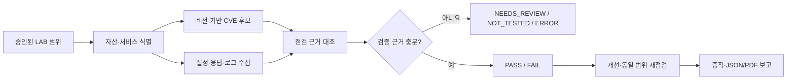

# 인프라 보안 취약점 진단 스캐너

**Python 기반 서비스·버전 식별 및 인프라 설정 진단 프로젝트**  
초기 팀 스캐너를 개인 후속 실습으로 확장하고, **설정·실제 응답·로그 수집 → 기준 비교 → 개선 → 동일 범위 재점검 → 근거 기록**을 연결했습니다.

> **검증 범위:** 모든 진단 및 개선 성과는 승인된 격리 LAB 또는 일회용 CI 환경에 한정됩니다. 실제 고객사 진단, KISA 전 항목 준수, 정식 인증심사 실적이 아닙니다.

**빠른 탐색:** [KISA 선정 점검 대장](docs/kisa-2026-final-scope-result.md) · [진단 항목별 검증 근거](docs/audit-evidence-mapping.md) · [Linux/MySQL 재점검](docs/linux-mysql-retest.md) · [WEB/WAS 점검](docs/web-was-audit.md) · [Notion 상세 포트폴리오](https://app.notion.com/p/300fef5673598095a2a5cc5107dcb62c)

## 1. 수행 범위와 본인 기여

| 구분 | 수행 내용 | 성과를 해석할 때의 한계 |
|---|---|---|
| **초기 팀 프로젝트** (2025.12~2026.01) | 서비스·버전 탐지, CVE 후보와 위험도 연계, 결과 보고 기능을 개발한 팀 프로젝트. **본인 담당으로 기록된 영역:** CVSS·EPSS 연동, AWS EC2 실습, 결과 보고서 작성 | 팀이 구현한 전체 코드를 개인 단독 개발로 표현하지 않음 |
| **개인 후속 확장** (2026.10~11) | Linux·Windows·가상 네트워크·DBMS·WEB/WAS·보안장비·AWS 설정 진단과 비교, LAB 개선·재점검, 보고서·증적 정리 | 대상 환경과 시점마다 검증 범위가 다름 |
| **웹 취약점 별도 LAB** | DVWA SQL Injection·Reflected XSS·File Upload 개선과 자동 재검증 | 실서비스 모의해킹이 아닌 취약점 학습·방어 검증 |

## 2. 문제를 어떻게 해결했는가

포트 개방이나 버전 일치는 취약점의 **후보**일 뿐, 실제 취약점 확정이 아닙니다. 이 프로젝트에서는 설정·서비스 응답·접속 결과와 원본 증적을 비교하고, 판단 근거가 부족한 경우 `NEEDS_REVIEW`, 실행·수집 오류에는 `ERROR`, 아예 검사하지 않은 경우 `NOT_TESTED`를 사용합니다.



판정 엔진: [`config_audit/engine.py`](config_audit/engine.py) · 상태 정의: [`config_audit/statuses.py`](config_audit/statuses.py) · 근거 매핑: [`docs/audit-evidence-mapping.md`](docs/audit-evidence-mapping.md)

## 3. 대표 진단·개선 사례

| 구분 | 실제로 확인한 내용 | 확인 자료 |
|---|---|---|
| **Linux·MySQL** | 별도 Replay LAB에서 SSH, 중요 파일 권한, DB 계정·권한·접근제한 등을 점검하고 **내부 LAB 10개 항목의 개선 전후 비교** 기록 | [Linux/MySQL 점검·재점검](docs/linux-mysql-retest.md) |
| **Nginx·Tomcat** | 설정·배포 파일·HTTP 응답을 교차 확인하고 **별도 LAB 8개 항목의 개선 전후 비교** 기록 | [WEB/WAS 분석](docs/web-was-audit.md) |
| **KISA 선정 WEB/MySQL** | 일회용 CI 환경에서 WEB-04·07·16, D-02·04·10을 **각 3개 FAIL→PASS**로 검증 | [KISA 최종 대장](docs/kisa-2026-final-scope-result.md) · [CI 실행 기록](https://github.com/LEESJ7934/infrastructure-security-scanner/actions/runs/42586652707) |
| **OPNsense 관리 접근통제** | 인가 1개·비인가 3개 경로의 사용자 수동 시험·로그를 대조 | [S-06·S-07 조건별 기록](docs/kisa-2026-final-scope-result.md) |
| **AWS** | 독립 내부전용 VPC의 SG 2개·NACL 2개 설정 조회와 접근정책 검토 | [AWS 후속 검토](docs/kisa-2026-external-followup.md) |
| **DVWA** | SQLi·XSS·파일 업로드 방어 로직 개선 및 **자동 재검증 37건 통과(2026-11-16 기록)** | [DVWA 검증 기록](docs/web-dvwa/README.md) |

**중복 집계 금지:** Replay LAB의 10개·WEB/WAS LAB의 8개, KISA 선정 점검 16개, DVWA 자동 테스트 37건, 전체 단위 테스트 1,354개는 **대상·환경·목적이 서로 다른 집계**입니다. 합쳐서 고유 취약점 수로 표현하지 않습니다.

### 판정 신뢰성의 한계

- **KISA 선정 16개:** 저장 대장에는 **PASS 15 / NEEDS_REVIEW 1**이 기록되어 있습니다. 그중 OPNsense **S-06 PASS는 사용자 지정 범위 수용**으로, 전체 PF·앵커 및 비인가 LAN→장비 WAN 관리주소 시험이 남아 있습니다. **필수 조건을 모두 증거로 충족한 항목은 14개**입니다.
- **AWS CA-09:** SG/NACL 기술 설정은 확인했지만 규칙별 업무목적 승인과 정기 검토 실적은 확인하지 못해 `NEEDS_REVIEW`입니다.
- **Suricata:** 시험 IP/ICMP 규칙의 IDS Alert·IPS Drop·복귀 기능 검증이며, 실제 유해 시그니처 전반의 탐지·차단 성능을 입증한 것은 아닙니다. KISA 선정 16개 집계에 포함하지 않습니다.
- 원시 파일 중 일부는 계정·환경 정보 보호를 위해 비공개로 보관합니다. 공개 보고서 예제는 **합성 데이터**입니다.

## 4. 주요 구성요소

| 경로 | 역할 |
|---|---|
| [`scanner/`](scanner/) · [`analysis/`](analysis/) | TCP/UDP 탐지, 서비스·버전 정보, CVE 후보·우선순위 분석 |
| [`config_audit/`](config_audit/) | 대상별 설정 수집·규칙 판단·상태 관리 |
| [`cloud_security/`](cloud_security/) | AWS 설정 진단 및 범위 관리 |
| [`scripts/`](scripts/) | LAB 실행·검사·보고·원시 증거 처리 |
| [`tests/`](tests/) | 판정 로직·수집기·보고서의 회귀 테스트 |
| [`docs/`](docs/) | 기준, 실제 점검 기록, 재점검, 미검증 조건 |

기술: Python 3.12, Docker, PowerShell, MySQL, AWS(boto3), Nginx, Tomcat, OPNsense, Suricata, GitHub Actions 등. 실제 사용 범위는 위의 대상별 기록을 우선합니다.

## 5. 실행과 테스트

```bash
python -m pip install -r requirements.txt -r requirements-reporting-test.txt
python -m unittest discover -s tests -p 'test_*.py'
```

공개용 합성 보고서 생성:

```bash
python -m scripts.generate_report_sample
```

[CI 워크플로](.github/workflows/ci.yml) · [샘플 JSON](examples/integrated-report-sample/sample-integrated-report.json) · [샘플 PDF](examples/integrated-report-sample/sample-integrated-report.pdf)

**이전 실행 결과(2026-11-19):** 전체 1,354개 중 1,332개 통과, 실패·오류 0, 22개 건너뜀(원본 증거 19건·별도 MySQL 환경 3건). 이번 README 수정안 작성 과정에서 테스트를 다시 실행한 것은 아닙니다. LAB와 외부 서비스에 의존하는 검사는 환경이 준비되지 않으면 실행할 수 없습니다.

## 6. 추가 검증이 필요한 범위

OPNsense S-06의 남은 경로·전체 PF 규칙, AWS CA-09의 조직 운영 승인·정기 검토, 일부 Windows 도메인/GPO와 실운영 조건, Suricata 활성 시그니처 전체, 실제 고객사의 운영 영향·정책 승인 등은 검증하지 않았습니다. **검증되지 않은 조건을 PASS 또는 실제 실무 경험으로 바꾸지 않습니다.**

[세부 진단 대장](docs/kisa-2026-final-scope-result.md) · [진단별 증거 기록](docs/audit-evidence-mapping.md) · [Notion 설명](https://app.notion.com/p/300fef5673598095a2a5cc5107dcb62c)
