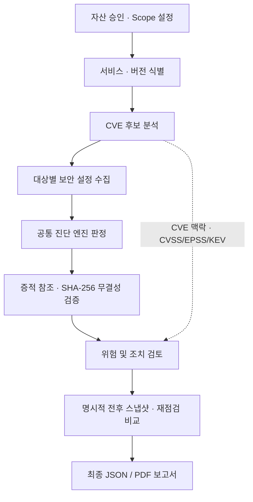

# Infrastructure Security Scanner

[](https://github.com/LEESJ7934/infrastructure-security-scanner/actions/workflows/ci.yml)

승인된 인프라 자산의 **서비스 식별 → CVE 후보 분석 → 보안 설정 진단 → 증적 관리 → 위험·조치 검토 → 재점검 비교 → JSON/PDF 보고서**를 구현한 정보보호 기술진단 프로젝트입니다.

팀 프로젝트(2025.12~2026.01)의 포트 스캐너·CVE 후보·위험평가를 기반으로, 이후 개인 확장에서 Day1~5 공통 설정 진단과 격리 실습·오프라인 보고서를 추가했습니다. 팀의 기존 결과와 개인 확장의 검증 범위를 구분합니다. 실제 고객사·운영 환경에 대한 검증이나 상용 진단 도구의 대체를 주장하지 않습니다.

**Python · MySQL · ReportLab · Docker 실습 · Hyper-V/OPNsense 실습 · AWS EC2/SG · GitHub Actions**

## 기술 아키텍처



**CVE 후보 분석과 CCE 성격의 설정 진단은 별도 검증 체계**입니다. 제품·버전 기반 후보를 CVE 확정으로 표시하지 않으며, 설정 `PASS`를 CVE 해소나 전체 보안성으로 해석하지 않습니다. 설정 진단의 `PASS / FAIL / NEEDS_REVIEW / ERROR / NOT_TESTED / NOT_APPLICABLE`과 기존 CVE 판정 상태를 임의로 합치지 않습니다.

## 대상별 실제 구현

| 대상 | 구현 범위 | 코드 |
|---|---|---|
| Linux | `sshd -T` 설정 5개 파싱, 빈 비밀번호·직접 root 로그인 정책 2개 판정. PAM·전체 계정 감사는 미구현 | [SSH 수집기](config_audit/collectors/linux_ssh.py) |
| MySQL | 설정 5개 파싱, LOCAL INFILE·암호화 전송 2개 판정 | [DBMS 수집기](config_audit/collectors/mysql_config.py) |
| Suricata | IDS 설정·규칙 로딩·구문 검사·합성 패킷 탐지 증적 6개 진단 | [IDS 수집기](config_audit/collectors/suricata.py) |
| ModSecurity | 엔진·감사 로그·요청 본문·CRS·실습 동작 등 6개 진단 | [WAF 수집기](config_audit/collectors/modsecurity.py) |
| OPNsense | 인터페이스, WAN 접근, 규칙 순서·범위, 로그, 정책 시험의 6개 항목. 조회 전용 API와 로컬 PF/로그 분석, 수동 증적 분리 | [방화벽 수집기](config_audit/collectors/opnsense.py) |
| AWS | EC2·Security Group 읽기 전용 조회, 광범위 허용 규칙 검토. AWS 조회 권한과 능동 스캔 승인은 별도 | [인벤토리](cloud_security/aws_inventory.py) · [SG 분석](cloud_security/aws_sg_analyzer.py) |
| 기존 스캐너 | 승인 범위 내 TCP/UDP·배너 식별, 검토된 CVE 후보, CVSS/EPSS/KEV와 자산 맥락 기반 우선순위 | [scanner](scanner/) · [analysis](analysis/) |

기존 FTP·SSH·HTTP·DVWA·Nuclei 검사와 EC2/격리 Docker 실습 결과는 [검증 방법](docs/validation.md), 설계 판단은 [아키텍처](docs/architecture.md)에 정리했습니다. 격리 환경의 조치 결과를 실제 EC2 설정 개선으로 주장하지 않습니다.

## Day1~5 개발 과정

| 단계 | 개인 확장 내용 | 기록 |
|---|---|---|
| Day1 | 공통 자산·규칙·관찰·판정 모델과 오프라인 엔진 | [개발 기록](docs/progress/DAY1.md) |
| Day2 | Linux/MySQL 수집기와 최초·재점검 스냅샷 | [개발 기록](docs/progress/DAY2.md) |
| Day3 | Suricata/ModSecurity 12개 진단과 격리 실습 증적 | [개발 기록](docs/progress/DAY3.md) |
| Day4 | OPNsense 조회·실제 패킷 시험, PF 스냅샷·로그 연계, 수동 증적 | [실습 종료 기록](docs/day4-completion.md) |
| Day5 | 결과 통합, 경로 제한·해시 검증, 전후 비교, 동일 스냅샷의 JSON/PDF | [최종 보고서](docs/day5-final-report.md) · [증적 인덱스](docs/day5-evidence-index.md) · [재점검 비교](docs/day5-comparison.md) |

## 실제 검증 결과와 한계

아래 수치는 **기존 로컬 증적 기반 Day5 보고서**의 결과이며 새로운 장비 실시간 진단이 아닙니다. 원본 보고서·일부 로컬 입력은 공개 저장소에 포함하지 않습니다.

| 지표 | 저장 자료 기준 |
|---|---|
| 자산 / 고유 자산·항목 / 시점별 레코드 | 5개 / 21개 / 25개 |
| 증적 파일 / 자산·항목·채널 연결 | 23개 / 60건 |
| PDF | 25페이지 |
| FW-04 / FW-05 | 수동 `NEEDS_REVIEW` 유지 |
| FW-06 | 해당 실습 범위의 수동 `PASS`, 자동 PASS로 대체하지 않음 |
| Day2 전후 | 원본 FAIL→PASS 2건, PASS→PASS 2건; 엄격한 비교는 `UNVERIFIABLE` 4건 |

Windows Python 3.12 가상환경의 최신 회귀 실행은 **694개 중 693개 통과**입니다. 기존 Git Bash `NtCreateDirectoryObject` 접근 거부 1건은 환경 오류로 남기며 테스트를 삭제하거나 성공 처리하지 않습니다. Ubuntu 결과는 상단 CI 배지와 [Actions 실행 기록](https://github.com/LEESJ7934/infrastructure-security-scanner/actions/workflows/ci.yml)에서 확인할 수 있습니다. 비공개 로컬 입력이 없는 체크아웃에서는 해당 입력 의존 테스트만 기존 조건에 따라 표시되며, 공개 합성 샘플의 PDF 통합 테스트는 항상 실행합니다.

후속 검증이 필요한 사항:

- FW-04 전체 유효 정책·앵커 범위와 FW-05 과거 로그의 규칙 세대 연속성
- 일부 증적의 독립 기대 해시 부재. 해시 일치는 진위·수집 완전성의 증명이 아님
- 자동·수동 채널 및 검증 범위·시각 분리
- 재점검의 범위·수집기·검증 방식 메타데이터와 조치 이력 부족

## 결과물 및 공개 데모

- [공개 샘플 PDF](examples/day5-demo/sample-integrated-report.pdf) · [예시 JSON](examples/day5-demo/sample-integrated-report.json)
- [샘플 설명·재현 방법](examples/day5-demo/README.md) · [합성 입력 생성 코드](scripts/generate_day5_sample.py)

샘플은 **SAMPLE / 합성 데이터 / 실제 점검 결과 아님**으로 표시합니다. 문서용 예약 IP만 사용하며 실제 로그·스크린샷·인증정보를 포함하지 않습니다. 예시 PASS·FAIL 라벨과 실제 `NOT_TESTED` 상태를 분리하고 VERIFIED 증적을 생성하지 않습니다.

## Windows 실행 방법

```powershell
.\.venv\Scripts\python.exe -m pip install -r requirements.txt -r requirements-reporting-test.txt
.\.venv\Scripts\python.exe -B -m unittest discover -s tests -p "test_*.py"

# 공개 합성 자료만으로 샘플 재생성
.\.venv\Scripts\python.exe -B -m scripts.generate_day5_sample

# 실제 로컬 입력이 별도로 준비된 경우의 오프라인 보고서
.\.venv\Scripts\python.exe -B -m scripts.run_day5_report
```

실제 수집에는 별도로 승인된 Scope, VM/실습 환경, 최소 권한 계정·자격증명이 필요합니다. 입력이 없으면 Day5 보고서는 부분 결과로 표시하며 실제 결과를 만들어 내지 않습니다. 루트 API 자동화·인증서 검증 우회·방화벽 정책 자동 변경은 허용하지 않습니다.
