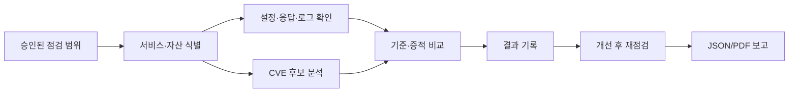
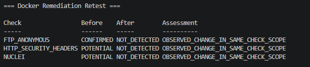

# 인프라 보안 진단 스캐너

Python으로 개발한 서비스 탐지·취약점 후보 분석 도구를 기반으로, **서버·DB·WEB/WAS 설정 진단과 개선 결과 검증**까지 확장한 프로젝트입니다. 단순히 점검 결과를 출력하는 데서 끝내지 않고 설정값, 실제 응답, 접근 결과를 대조해 판단 근거를 남기는 데 중점을 뒀습니다.

**프로젝트 구분:** 초기 팀 개발(2025.12~2026.01) / 개인 후속 확장(2026.10~11)  
**시험 환경:** 격리 LAB와 일회용 CI 환경

[Notion에서 프로젝트 보기](https://app.notion.com/p/300fef5673598095a2a5cc5107dcb62c) · [아키텍처](docs/architecture.md) · [진단 근거](docs/audit-evidence-mapping.md)

## 프로젝트에서 맡은 일

| 구분 | 주요 작업 |
| --- | --- |
| 초기 팀 개발 | CVSS·EPSS 연동, AWS EC2 실습, 진단 결과 보고서 작성 |
| 개인 후속 확장 | Linux·Windows·가상 네트워크·MySQL·WEB/WAS·보안장비·AWS 설정 진단과 개선 후 재점검 |
| 별도 웹 보안 실습 | DVWA SQL Injection·Reflected XSS·File Upload 방어와 회귀 검증 |

팀 전체가 개발한 기능과 개인 후속 작업은 구분해 기록했습니다.

## 대표 작업

### MySQL — 권한 설정과 실제 접근 결과 비교

계정·권한 목록을 확인한 뒤 불필요한 계정, 관리자 권한, 원격 접근 경로를 점검했습니다. 개선 후에는 **허용된 출발지의 TCP 연결·SELECT 성공**과 **비허용 출발지의 연결 제한·방화벽 카운터**를 함께 확인했습니다. D-02·D-04·D-10의 개선 전후 판정은 별도의 일회용 CI LAB에서 검증했습니다.

[점검 기준·실측 결과](docs/kisa-2026-final-scope-result.md) · [Linux/MySQL 추가 실습](docs/linux-mysql-retest.md)

### Nginx·Tomcat — 설정 파일과 HTTP 응답 교차 확인

설정 선언만으로 판단하지 않고 실제 적용 설정, 배포 파일 목록, 정상·오류 HTTP 응답을 비교했습니다. 디렉터리 리스팅, 불필요 파일, 헤더 노출과 관련된 WEB-04·WEB-07·WEB-16을 동일 LAB 조건에서 조치 전후 검증했습니다.

[WEB/WAS 점검 기록](docs/web-was-audit.md) · [CI 실행 기록](https://github.com/LEESJ7934/infrastructure-security-scanner/actions/runs/42586652707)

### 취약점 후보와 확정 판정 구분

서비스 버전으로 찾은 CVE는 **검토 후보**로 취급합니다. 실제 설정·응답·증적이 충분한지 확인한 뒤 결과를 분류하며, 미수집·오류·판단 근거 부족을 일률적으로 안전 또는 취약으로 처리하지 않도록 했습니다.

[판정 구조와 설계 이유](docs/architecture.md) · [판정 근거 매핑](docs/audit-evidence-mapping.md)

## 동작 흐름



**별도 Docker 실습 화면:** FTP·HTTP 서비스의 개선 전후 재점검 사례입니다. 위의 MySQL·WEB/WAS 일회용 CI와는 다른 실습입니다.



## 실행 및 결과 확인

```bash
python -m pip install -r requirements.txt -r requirements-reporting-test.txt
python -m unittest discover -s tests -p 'test_*.py'
python -m scripts.generate_report_sample
```

[CI 워크플로](.github/workflows/ci.yml) · [보고서 예시(JSON)](examples/integrated-report-sample/sample-integrated-report.json) · [보고서 예시(PDF)](examples/integrated-report-sample/sample-integrated-report.pdf)

## 진단 범위와 증적

대표 사례는 **재현 가능한 LAB 설정 및 접근 시험**입니다. 고객사 운영환경에서 발견한 취약점이나 공식 KISA 적합 판정을 의미하지 않습니다. KISA 선정 항목의 개별 PASS/REVIEW 판정, 서로 다른 LAB의 결과와 미검증 경로는 원본 대장에 보존했습니다. 특히 OPNsense S-06은 일부 접근경로와 전체 PF 규칙이 미확인 상태이므로 대표 검증 완료 성과로 사용하지 않습니다.

[선정 16개 항목의 판정·미검증 조건](docs/kisa-2026-final-scope-result.md) · [진단 항목별 원본 근거](docs/audit-evidence-mapping.md) · [그 외 점검 기록](docs/)
