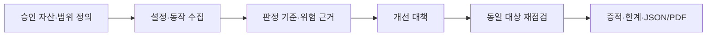

# Infrastructure Security Scanner

[](https://github.com/LEESJ7934/infrastructure-security-scanner/actions/workflows/ci.yml)

**취약한 설정을 찾는 것에서 끝내지 않고, 판정 근거·개선 대책·같은 대상의 재점검 결과를 설명하는 인프라 기술진단 포트폴리오입니다.**

서버·네트워크·DBMS·WEB/WAS·보안장비 5개 분야와 AWS를 대상으로, 승인 범위를 정하고 설정을 읽어 내부 LAB 기준으로 판단한 뒤 JSON/PDF와 증적 참조로 전달합니다. 실제 고객사나 운영환경의 진단·컨설팅 수행 경험, KISA 공식 인증을 주장하지 않습니다.

## 팀 프로젝트와 개인 확장

- **팀 프로젝트 기반(2025.12~2026.01):** 포트·서비스 식별, CVE 후보, DB 저장, 위험평가 및 보고서 흐름을 출발점으로 사용했습니다. 기존 팀 기능 전체를 개인 단독 개발로 설명하지 않습니다.
- **개인 후속 확장:** Day1~5 공통 설정 진단 엔진·수집기·증적 인덱스·재점검·JSON/PDF와 Phase2 대상별 진단 및 격리 LAB을 추가했습니다. LAB/STRICT, 자동/수동, 합성/실제 수집을 구분합니다.
- 기여·증거·면접 표현의 단일 기준: [포트폴리오 근거 매핑](docs/portfolio-evidence-mapping.md).

## 기술진단 절차



수집값은 `AuditRule / Observation / evaluate()`로 평가합니다. `PASS / FAIL / NEEDS_REVIEW / ERROR / NOT_TESTED / NOT_APPLICABLE`을 보존하며, 미수집·오류를 PASS로 바꾸지 않습니다. CVE 후보 분석은 별도 체계입니다. 버전 일치를 취약점 확정으로, 설정 PASS를 CVE 해소나 전체 보안성으로 해석하지 않습니다.

## 진단 영역과 실제 수행 수준

| 분야 | 점검 내용·방법 | 확인된 수준과 한계 |
|---|---|---|
| 서버 — Linux | `sshd -T`, 중요 파일 소유권·권한, LAB 서비스 리스너, rsyslog 인증 로그 경로 | Phase2 Replay에서 Linux 5건 FAIL→PASS. 실제 SSH 로그인·로그 전달·모든 서비스 점검은 아님 |
| 서버 — Windows Server | Guest, 암호·잠금, Spooler, 방화벽, SMB, 감사 정책. 읽기 전용 PowerShell JSON과 수동 확인 분리 | Server 2022 build 20348 저장 자료의 LAB 재분석 PASS 8 / NEEDS_REVIEW 1. 개선 3건은 수동 확인을 포함하며 2019/2025 미검증 |
| 네트워크 — Router/Switch | Linux/FRRouting 노드의 관리 서비스·전용 nft input 정책·bridge 연결 목록 | R03/R04 2건 개선. 별도 LAB에서 양방향 Router 경유 확인. 물리 장비·Switch 관리면·802.1Q VLAN은 검증하지 않음 |
| DBMS — MySQL | 계정 Host·익명 계정, GLOBAL 변수, 지정 앱 계정의 역할·권한 | MySQL 8.4.13 Replay 5건 FAIL→PASS. 실제 TCP TLS handshake·운영 DB 전체 권한 감사는 아님 |
| WEB/WAS — Nginx/Tomcat | 디렉터리·불필요 경로·버전 노출·로그, 자동배포·기본 앱·오류 응답 | Nginx 4건/Tomcat 4건 FAIL→PASS, 전후 프록시 HTTP 정상. 가상 LAB·정해진 경로의 시험 |
| 보안장비 — OPNsense | 인터페이스·WAN 접근·PF 규칙·로그·정책 적용을 API/스냅샷/수동 채널로 구분 | FW-02/03/06 수동 PASS, FW-04/05 NEEDS_REVIEW. 전체 정책·과거 규칙 연속성 미확인 |
| 보안장비 — ModSecurity | 엔진·감사·본문·CRS 설정 및 GET/PUT와 감사 이벤트 상관분석 | WAF 6개 PASS 요약 존재. 원시 HTTP/감사 로그가 없어 현재 파일만으로 실제 차단을 독립 재확인할 수 없음 |
| 추가 — AWS | IAM/SG/VPC/NACL/CloudTrail/Flow Logs P1 8개. Scope 제한 읽기 전용 수집·정규화 | 독립 LAB 4건 FAIL→PASS. CT-01 FAIL, IAM-03 NEEDS_REVIEW 유지. 설정 판정이며 패킷 차단·로그 전달 증명 아님 |

**Suricata IDS/IPS는 최종 검증 성과·개선 완료 집계에서 제외합니다.** 기존 코드·테스트·역사적 Day3 보고서는 보존합니다. 영역별 세부 항목과 근거는 [근거 매핑](docs/portfolio-evidence-mapping.md), 구현 경계는 [최종 통합 범위](docs/phase2-final-integration.md)에 있습니다.

## 대표 취약 설정 → 개선 → 재점검

| 사례 | 위험 판단과 대책 | 저장 증적에서 확인한 결과 |
|---|---|---|
| Linux 직접 root 로그인·암호 인증 | 원격 관리 노출을 줄이도록 두 정책을 비활성화. 운영 적용 전 별도 키 접근 확보 필요 | `LINUX-LAB-001/002`: 유효 설정 yes→no |
| MySQL 원격 root·과도한 앱 권한 | 원격 root 제거, 지정 테이블 SELECT로 최소화 | `MYSQL-LAB-002/005`: 대상 계정 1→0, EXCESSIVE→USAGE/SELECT |
| Windows 암호·잠금·SMB 서명 | 최소 길이 14, 잠금 10회/30분, 서버 서명 필수 | 0→14, 0→10, False→True는 사용자 PowerShell 확인 출처를 포함한 LAB 개선 3건 |
| Nginx/Tomcat 정보·경로 노출 | 목록/버전·불필요 경로·기본 앱을 제한하고 접근 로그 활성화 | 구성 및 제한된 HTTP 응답 재확인, 전후 health endpoint 정상 |
| AWS 관리 포트 공개·내부 서브넷 공개 설정 | 미부착 SG 공개 규칙 제거, 내부 대상의 자동 공인 IP·IGW 기본 경로 제거 | 같은 LAB SG/Subnet 재조회 PASS. 인터넷 도달 가능성 시험으로 해석하지 않음 |

Linux와 MySQL을 합한 Phase2 **10건**은 별도 Replay LAB의 결과입니다. Day2의 개선 2건과 합산하거나 같은 baseline으로 취급하지 않습니다. Windows의 수동 baseline을 자동 수집값으로 위조하지 않습니다.

## 개선 전후 결과와 증적

- Linux/MySQL Replay: FAIL 10 → PASS 10, `IMPROVED_OBSERVED` 10건.
- WEB/WAS: FAIL 8 → PASS 8, Nginx→Tomcat HTTP 정상.
- Router: R03/R04 FAIL→PASS. 별도 packet LAB에서 양방향 각 3/3, TTL·각 경유 단계 확인.
- AWS 독립 LAB: SG-01/NACL-01/VPC-01/FL-01 FAIL→PASS, 개선 관찰 4건. CT-01과 IAM-03은 미해결로 남깁니다.
- OPNsense: WAN→방화벽 TCP 443/22 및 LAN→WAN ICMP의 **수동 시험 범위**에 한정합니다.

모든 수치는 **기존 로컬 자료 대조**에 근거하며 이번 문서 작업에서 장비를 새로 조회한 결과가 아닙니다. [근거 매핑의 증적 목록](docs/portfolio-evidence-mapping.md#증적-및-보고서-목록)에 실제 파일 경로와 없는 자료를 구분했습니다.

## JSON/PDF와 공개 샘플

공통 모델, 증적 경로 제한·SHA-256, 명시적 before/after 관계, 판정 채널·범위·시각을 보고서에 연결합니다. 해시 일치는 **현재 파일 무결성**이며 수집 출처의 진위 인증이나 완전성 증명이 아닙니다. 재점검 개선 관찰도 조치의 인과관계 전체를 증명하지 않습니다.

- [공개 합성 PDF](examples/day5-demo/sample-integrated-report.pdf) · [합성 JSON](examples/day5-demo/sample-integrated-report.json) · [샘플 설명](examples/day5-demo/README.md)
- [Day5 보고서 구조](docs/day5-final-report.md) · [증적 인덱스](docs/day5-evidence-index.md) · [재점검 비교](docs/day5-comparison.md)

실제 `logs/`, `reports/`, `evidence/`, AWS 계정/자산 Scope와 Terraform state·개인 변수는 공개 샘플이 아닙니다. 링크가 아닌 로컬 경로로만 설명하며 원본을 Git에 추가하지 않습니다. 기존 Day5 25레코드 보고서는 역사적 산출물로서 현재 Phase2 성과 합계가 아닙니다.

## 검증 한계와 테스트 기록

- 내부 개인 LAB 기준입니다. 공식 KISA 항목 ID·기업 정책·운영환경 적합성을 임의로 확정하지 않습니다.
- 설정 확인, 패킷 경로, 수동 확인, 자동 판정을 분리합니다. 미지원 Switch 기능과 미완료 감사·로그/규칙 연계는 숨기지 않습니다.
- AWS LAB 정리는 완료되지 않았습니다. 현재 자원·비용은 별도 인증/조회가 필요하며 기존 state·증적을 보존합니다.
- Git 최종 통합 기준(2026-11-07, Windows/Python 3.12.10, `99c8f10`): 핵심 **322개 통과**, 전체 **1,300개 통과 / 1개 실패**. 기존 WSL `/bin/bash` 오류를 성공으로 처리하지 않습니다.
- 330/381/694개 등의 과거 수치는 당시 단계·환경의 기록입니다. 현재 CI 성공 여부나 새 실행 결과로 대신 사용하지 않습니다. 이번 재실행 기록은 [테스트 기준표](docs/portfolio-evidence-mapping.md#테스트-기록과-기준)에 구분합니다.

## 오프라인 실행·재현

프로젝트 루트 Windows PowerShell:

```powershell
.\.venv\Scripts\python.exe -m pip install -r requirements.txt -r requirements-reporting-test.txt
.\.venv\Scripts\python.exe -B -m unittest discover -s tests -p "test_*.py"

# 공개 합성 자료: 실제 점검 결과나 VERIFIED 증적을 만들지 않음
.\.venv\Scripts\python.exe -B -m scripts.generate_day5_sample

# 명시적인 로컬 입력이 별도로 있을 때만 기존 저장 결과를 오프라인 통합
.\.venv\Scripts\python.exe -B -m scripts.run_day5_report
```

실제 수집·개선은 각 LAB의 별도 승인 범위와 실행 옵션을 확인해야 합니다. 위 문서 검증에서는 VM·Docker·SSH·DB·AWS를 실행하지 않습니다. 샘플 생성과 Day5 실행은 출력 파일을 쓰므로 원본 보고서 보존 정책을 확인한 뒤 별도 출력 위치를 사용하세요.

## 상세 문서와 코드

- [검증 기록](docs/validation.md) · [아키텍처](docs/architecture.md) · [면접/Notion/PPT 공통 근거](docs/portfolio-evidence-mapping.md)
- 서버: [Linux/MySQL 실습](docs/phase2-linux-mysql-recovery.md) · [Windows](docs/phase2-windows-server.md)
- 네트워크: [설정 진단](docs/phase2-network-devices.md) · [패킷 경유](docs/phase2-network-packets.md)
- WEB/WAS: [Nginx/Tomcat](docs/phase2-web-was.md)
- 보안장비: [OPNsense](docs/day4-opnsense.md) · [FW-04 PF](docs/day4-pf-snapshots.md) · [FW-05 로그](docs/day4-fw05-log-rule-evidence.md)
- AWS: [오프라인](docs/phase2-aws-offline.md) · [읽기 전용 수집](docs/phase2-aws-collection.md) · [범위 스키마](docs/phase2-aws-scope-v2.md) · [독립 Terraform LAB](infra/aws/phase2-audit-lab/README.md)
- 기존 코드: [scanner](scanner/) · [analysis](analysis/) · [Linux SSH](config_audit/collectors/linux_ssh.py) · [MySQL](config_audit/collectors/mysql_config.py) · [ModSecurity](config_audit/collectors/modsecurity.py) · [AWS 인벤토리](cloud_security/aws_inventory.py) · [SG 분석](cloud_security/aws_sg_analyzer.py)

| 개발 단계 | 개인 확장 기록 |
|---|---|
| Day1 | [공통 설정 진단 엔진](docs/progress/DAY1.md) |
| Day2 | [Linux/MySQL 최초 4개 실습](docs/progress/DAY2.md) |
| Day3 | [IDS/WAF 역사적 개발 기록](docs/progress/DAY3.md). IDS는 현재 성과 제외 |
| Day4 | [OPNsense 종료 기록](docs/day4-completion.md) |
| Day5 | [오프라인 통합·증적·재점검·보고서](docs/day5-final-report.md) |
