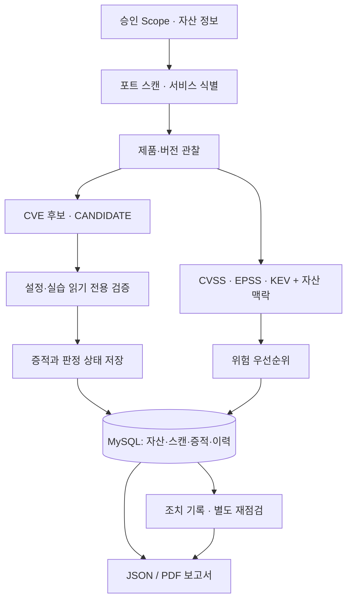

# 인프라 보안 진단 스캐너
**Infrastructure Security Scanner**

승인된 자산의 서비스·버전을 식별하고, **CVE 후보 / 실제 설정 검증 / 위험 우선순위 / 증적 / 재점검 / 보고서**를 구분해 관리하는 인프라 보안 진단 프로젝트입니다.

**[노션 포트폴리오: 담당 역할·검증 결과·실제 스크린샷 보기](https://app.notion.com/p/300fef5673598095a2a5cc5107dcb62c)**

| 구분 | 내용 |
|---|---|
| 수행 구분 | 팀 프로젝트(2025.12–2026.01) / 이후 기능 확장·실습 검증 |
| 주요 기술 | Python, MySQL, Docker, AWS EC2, Nuclei, NVD CVSS, FIRST EPSS, CISA KEV |
| 검증 기록 | Python 회귀 테스트 330개 통과, 격리 Docker/MySQL/Nuclei E2E |
| 주요 결과 | EC2·로컬 실습 증적 5/5 MATCH, 별도 Docker 환경의 동일 대상 재점검 |

## 기술진단 데이터 흐름

*검사 단계는 승인과 실행 조건에 따라 각각 호출됩니다. 도식은 데이터의 논리적 연결이며 자동 연속 실행을 뜻하지 않습니다.*

## 핵심 구현

| 영역 | 주요 구현 | 근거 |
|---|---|---|
| 승인 범위 · 자산 | IP/CIDR/호스트 허가 범위·기간·스캔 한도와 자산 중요도 관리 | `scanner/`, `asset_management/` |
| 서비스 · CVE 후보 | 서비스 응답·버전과 검토된 4개 CVE의 공식 영향 범위 비교 | `analysis/`, `scanner/` |
| 검증 · 판정 | FTP·SSH·HTTP·DVWA·Nuclei, 후보·가능성·해당 검사 확인 구분 | `verification/`, `lab/` |
| 위험 우선순위 | CVSS·EPSS·KEV·자산 맥락을 고려하되 확정 여부와 분리 | `analysis/` |
| 증적 · 보고서 | 검사 시각·판정·SHA-256·이력과 JSON/PDF 통합 | `sql/`, `scripts/` |
| 클라우드 | EC2·Security Group 읽기 전용 조회와 스캔 승인 분리 | `cloud_security/`, `infra/aws/` |

## 검증 범위와 한계

| 환경 | 관찰·검증 | 해석 |
|---|---|---|
| 승인 EC2 실습 | FTP 익명 로그인, SSH 기본 인증 정책, HTTP 보안 헤더, DVWA 실습 | 해당 시점·검사 범위의 관찰 |
| EC2 + 로컬 증적 | 저장 증적 5/5 MATCH 및 통합 Snapshot MATCH | 내용 일치 확인, 원격 출처 인증 아님 |
| GitHub Actions 격리 Docker | 같은 FTP·HTTP 서비스 설정 개선 전후, Nuclei·MySQL·보고서 | 실제 EC2 설정을 개선한 결과 아님 |
| 회귀 테스트 | Python 330개 통과 | 기능 테스트이며 운영 적합성 보증 아님 |

[기본 CI 실행 결과](https://github.com/LEESJ7934/infrastructure-security-scanner/actions/runs/39456387487) · [Docker 통합 검증](https://github.com/LEESJ7934/infrastructure-security-scanner/actions/runs/39453811884)

**CANDIDATE**(버전 기반 후보), **POTENTIAL**(설정 위험 가능성), **CONFIRMED**(해당 검사 조건 확인)는 다릅니다. **NOT_DETECTED**, **ERROR**, **NOT_TESTED**도 각각 미발견·검사 실패·미검사를 의미합니다. CVE 자동 확정이나 운영환경 전체 안전을 주장하지 않습니다.

## 구현 코드·설계·재현 자료

- [아키텍처와 설계 판단](docs/architecture.md) · [검증 방법 및 판정 기준](docs/validation.md)
- 코드: `scanner/` · `asset_management/` · `analysis/` · `verification/` · `cloud_security/`
- 데이터베이스·인프라: `sql/` · `docker/` · `infra/aws/`
- 회귀·격리 검증: `tests/` · `lab/` · [GitHub Actions](.github/workflows/lab_integration.yml)
- **실제 점검 화면·조치 전후·통합 보고서:** [노션 상세 포트폴리오](https://app.notion.com/p/300fef5673598095a2a5cc5107dcb62c)

검증 이미지 원본은 `docs/images/`에서 관리합니다. 이 README에서는 노션과 중복되는 스크린샷을 다시 렌더링하지 않습니다.
