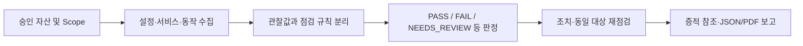

# 인프라 기술적 취약점 진단 스캐너

[](https://github.com/LEESJ7934/infrastructure-security-scanner/actions/workflows/ci.yml)

승인된 점검 범위 안에서 **자산 식별 → 설정·동작 수집 → 보안 기준 판정 → 개선 전후 재점검 → 증적 및 보고서 작성**을 연결한 인프라 보안 진단 프로젝트입니다. 단순히 열린 포트나 취약점 후보를 나열하는 데 그치지 않고, **무엇을 확인했고 무엇은 확인하지 못했는지**를 구분하도록 설계했습니다.

**먼저 확인하기:** [실제 LAB 진단 결과](docs/kisa-2026-final-scope-result.md) · [진단 근거와 한계](docs/audit-evidence-mapping.md) · [공개 보고서 PDF 예시](examples/integrated-report-sample/sample-integrated-report.pdf) · [재현 방법](#실행과-재현)

## 핵심 결과

| 구분 | 검증된 내용 |
| --- | --- |
| KISA 선정 점검 범위 | **16개 항목 중 PASS 13개, NEEDS_REVIEW 3개** (2026-11-09 기준) |
| 재점검 예시 | Linux/MySQL 별도 Replay LAB **10건 FAIL → PASS**; WEB/WAS 별도 LAB **8건 FAIL → PASS** |
| 진단 대상 | Linux·Windows·네트워크 장비 LAB·MySQL·Nginx/Tomcat·OPNsense·ModSecurity·AWS |
| 산출물 | 자산·범위·판정 이유·증적 참조·개선 전후 비교를 연결한 JSON/PDF |
| 검증 수단 | 단위 테스트, GitHub Actions, 격리 Docker LAB, 제한된 실제 설정·HTTP·API 수집 |

위 수치들은 **서로 다른 시점과 실습 환경**에서 확보한 결과이며 하나의 통합 실행 성과로 합산하지 않습니다. 선정 16개 중 **S-06·S-07(OPNsense), CA-09(AWS)는 검증 조건이 부족해 NEEDS_REVIEW**로 남겼습니다. [항목별 근거·수집 시각·미완료 조건](docs/kisa-2026-final-scope-result.md)을 확인할 수 있습니다.

## 프로젝트 구성과 담당 범위

- **팀 프로젝트 기반 (2025.12~2026.01):** TCP/UDP 스캔, 서비스·버전 식별, CVE 후보 조회, DB 저장과 보고서 흐름을 구축했습니다. 팀에서 구현한 기능 전체를 개인 개발 결과로 표시하지 않습니다.
- **개인 후속 확장 (2026.10~11):** 승인 대상·실행 범위 관리, Linux/MySQL 등 설정 진단, 재점검·증적 검토, AWS 설정 감사, JSON/PDF 통합 보고와 격리 실습을 보완했습니다.
- **판단 기준:** 수집 실패는 PASS가 아닙니다. 후보 취약점과 확인된 취약점, 자동·수동 판정, 실제 관찰·합성 예제를 구분합니다.

기술 스택: **Python, Docker, PowerShell, MySQL, AWS(boto3), GitHub Actions**, JSON/PDF 보고서 생성.

## 진단 처리 구조



| 설계 요소 | 구현 의도 | 관련 코드·문서 |
| --- | --- | --- |
| 범위 통제 | 승인 자산·스코프·실행 모드를 명시하고 임의 대상 확장을 제한 | [자산 관리](asset_management/) · [AWS 범위](docs/aws-scope-validation.md) |
| 기준 기반 진단 | 관찰값과 규칙을 분리하여 실패·미확인 상태를 명시 | [설정 진단](config_audit/) · [대상별 진단 근거](docs/audit-evidence-mapping.md) |
| 취약점 후보 관리 | 배너·버전 기반 CVE 후보와 실제 재현·확정 결과를 구분 | [스캐너](scanner/) · [위험 분석](analysis/) |
| 증적·보고서 | 검증 시각·경로·해시·재점검 관계와 제한사항을 함께 기록 | [증적 무결성](docs/evidence-integrity.md) · [통합 보고서](docs/integrated-report.md) |

## 대표 진단 사례

| 대상 | 확인 및 개선한 항목 | 검증 범위 |
| --- | --- | --- |
| Linux | SSH 직접 root 로그인·암호 인증, 파일 권한 등 설정 변경 후 재수집 | 격리된 Linux Replay LAB의 유효 설정 |
| MySQL | 원격 root·불필요한 계정 및 과도한 권한을 제한하고 계정·권한 재조회 | 별도 MySQL LAB 및 선택 항목의 실제 클라이언트 테스트 |
| WEB/WAS | Nginx/Tomcat의 디렉터리·배포 파일·정보 노출 설정을 변경하고 HTTP 응답 재확인 | 고정된 테스트 경로와 LAB 배포 루트 |
| AWS | 보안 그룹·서브넷·라우트·Flow Logs 설정을 조회하고 일부 개선 전후 비교 | 승인된 독립 LAB 리소스만 해당 |
| OPNsense | WAN 관리 접근·PF 규칙·로그를 수동 증적과 API 결과로 구분 | 일부 정책은 전체 규칙 조회 권한 부족으로 미확정 |

[개선 전후 결과 상세](docs/remediation-comparison.md) · [KISA 대표 진단 사례](docs/kisa-2026-case-studies.md) · [장비별 참고 자료](docs/audit-evidence-mapping.md)

## 결과물 미리 보기

**[통합 진단 보고서 PDF 샘플 열기](examples/integrated-report-sample/sample-integrated-report.pdf)**

[샘플 JSON](examples/integrated-report-sample/sample-integrated-report.json) · [합성 데이터와 판정 기준 설명](examples/integrated-report-sample/README.md)

공개 샘플은 **가상 자산과 문서용 IP로 생성**했습니다. 실제 장비 검사·실측 PASS를 뜻하지 않으며, 샘플의 실제 진단 상태는 **NOT_TESTED**입니다. 운영 증적과 개인정보·자격증명은 포함하지 않습니다.

## 실행과 재현

Python 3.12 기준으로 저장소 루트에서 실행합니다. Docker와 실제 장비는 기본 테스트에 필요하지 않습니다.

```bash
python -m pip install -r requirements.txt -r requirements-reporting-test.txt
python -m unittest discover -s tests -p "test_*.py"
```

공개 합성 보고서만 다시 만들 때:

```bash
python -m scripts.generate_report_sample
```

이 명령은 `examples/integrated-report-sample/`의 JSON/PDF 파일을 다시 씁니다. PDF 바이트 및 페이지 수는 설치된 글꼴·라이브러리 환경에 영향을 받을 수 있습니다. 실제 로컬 결과를 통합하는 실행기는 [`scripts/run_integrated_report.py`](scripts/run_integrated_report.py)이며, 필요한 원본 입력과 출력 정책을 먼저 확인해야 합니다.

실제 네트워크·방화벽·AWS 수집은 이 README만으로 자동 실행되지 않습니다. **승인된 독립 실습 환경**과 장비별 실행 조건을 확인한 뒤 진행해야 합니다.

## 검증 및 남은 한계

- **CI:** [자동 테스트·컴파일·비밀정보 검사](https://github.com/LEESJ7934/infrastructure-security-scanner/actions/workflows/ci.yml) 및 격리 LAB 검증. 일부 테스트는 저장소에 없는 로컬 증적 때문에 건너뜁니다.
- **미완료 항목:** [S-06·S-07·CA-09 후속 검증 조건](docs/kisa-2026-external-followup.md). 수집 일부 성공이나 API 오류를 전체 PASS로 처리하지 않습니다.
- **제외 항목:** Suricata IDS/IPS의 인라인 차단은 최종 검증 성과에 포함하지 않았습니다. 일부 LAB와 문서는 과거 실험 재현 목적으로 남겼습니다.
- **적용 범위:** 연구·학습을 위한 격리 LAB와 승인 자산 기반의 기술 점검입니다. 고객사 컨설팅 수행, 전체 운영 인프라 진단, KISA 공식 인증·전체 항목 준수를 의미하지 않습니다.

상세 기술 문서: [전체 아키텍처](docs/architecture.md) · [KISA 선정 범위](docs/kisa-2026-selection-freeze.md) · [진단 증적 매핑](docs/audit-evidence-mapping.md) · [검증 한계와 이력](docs/history/kisa-2026-6of16.md).
