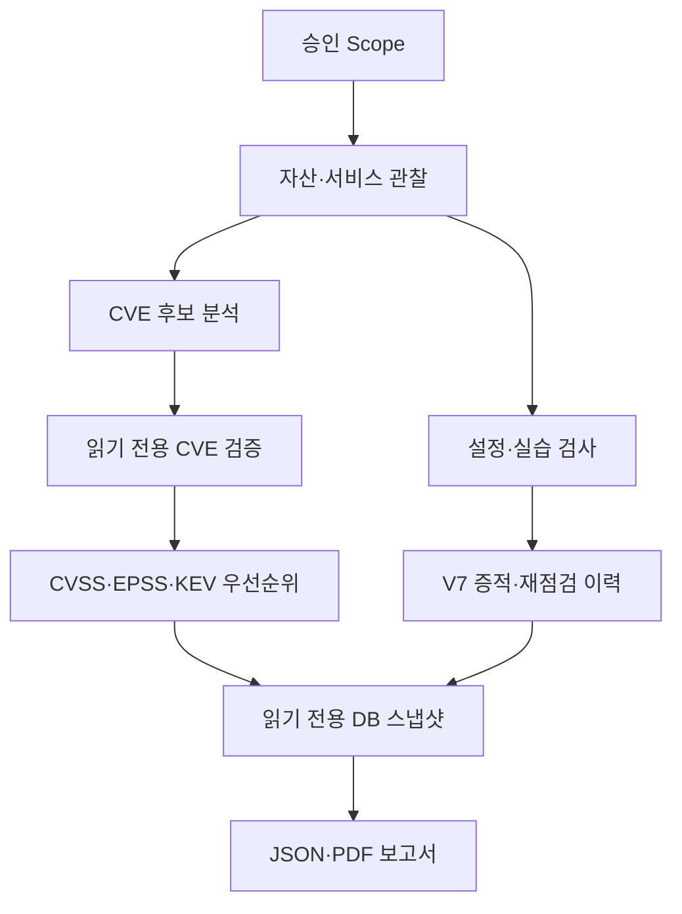
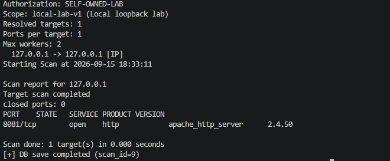
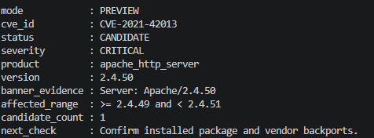
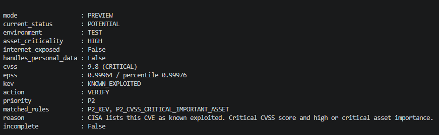
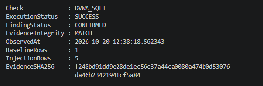
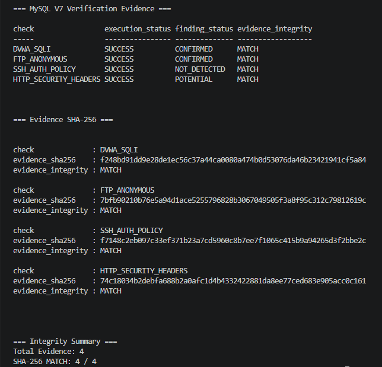
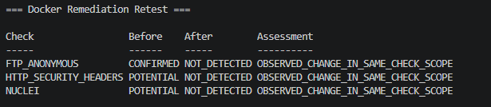
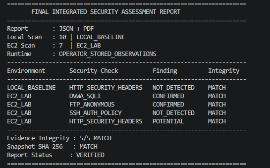

# 인프라 보안 진단 스캐너

승인된 범위의 자산·서비스를 식별하고, **CVE 후보와 실제 설정·실습 검증을 구분하여 증적·개선 권고·재점검·보고서로 연결**하는 기술진단 프로젝트입니다.

- **팀 프로젝트:** 2025.12~2026.01. 이후 기능 보완·실측·자동 검증은 같은 프로젝트의 후속 작업입니다. 초기 팀 기간의 공동 성과로 소급하지 않습니다.
- **문서 기준:** `main` 통합 커밋 `51aae3a65406410ebe7ebb5ba2c107d8928722a7`.
- **환경:** Python 3.10+, MySQL **8.0 / 프로젝트 스키마 V7**, Docker, Nuclei. V7은 MySQL 제품 버전이 아닙니다.
- [채용용 프로젝트 요약](https://www.notion.so/300fef5673598095a2a5cc5107dcb62c) · [상세 수행 이력](docs/project_story.md) · [스크린샷 촬영 안내](docs/portfolio_capture_guide.md)

## 1. 해결한 문제와 설계

열린 포트나 버전 일치만으로 취약점을 확정하면 오탐과 잘못된 조치 권고가 발생합니다. 승인 범위, 관찰값, 후보 선정 근거, 검증 결과를 분리하고 각 결과를 스캔·자산·포트에 연결했습니다.



| 구현 | 기술적 판단 | 근거 |
|---|---|---|
| TCP/UDP 및 서비스·버전 식별 | 관찰한 배너와 설치 패키지·패치 상태를 구별 | [scanner](scanner/), [식별·매핑](docs/service_cve_mapping.md) |
| 승인 Scope | 대상·유효기간·대상 수·포트 수·동시 작업 수 사전 검증 | [scope.py](scanner/scope.py), [테스트](tests/test_scope.py) |
| 검토된 4개 CVE 규칙 | 일치는 후보이며 미일치는 안전 판정이 아님 | [규칙](analysis/vuln_rules.json), [CVE verifier](verification/cve_verifiers.py) |
| CVE 우선순위 | CVSS·EPSS·KEV에 자산 중요도·노출·현재 상태를 함께 적용 | [risk_engine.py](analysis/risk_engine.py), [테스트](tests/test_risk_assessment.py) |
| FTP·SSH·HTTP | 익명 인증, 기본 SSH 인증 정책, 보안 헤더를 검사 | [검사기](verification/), [EC2 증적 수집](scripts/collect_ec2_config_evidence.py) |
| DVWA·Nuclei | 승인 실습의 비파괴 SQLi 행 확대, 검토한 헤더 템플릿 실행 | [DVWA](verification/dvwa_sqli_lab.py), [Nuclei](verification/reviewed_nuclei.py) |
| 스키마 V7 | 실행 상태와 판정·시각·Scope·증적 해시를 별도 이력으로 저장 | [migration_v7.sql](sql/migration_v7.sql), [저장 계층](db/lab_repository.py) |
| 재점검·통합 보고서 | 동일 검사 대상만 전후 비교하고 누락 검사는 별도 표시 | [비교 로직](scripts/generate_lab_comparison.py), [보고서](scripts/generate_integrated_lab_report.py) |

**평가 방식의 구분:** CVE 우선순위는 `risk_engine.py`의 규칙 기반 평가입니다. FTP·HTTP·SSH·DVWA의 V7 결과는 `generate_lab_comparison.py`의 검사별 정성적 가이드이며, 모든 설정 검사에 CVSS·EPSS·KEV를 적용한 것은 아닙니다.

## 2. 판정 기준

| 표시 | 의미 | 해석하지 말아야 할 것 |
|---|---|---|
| `CANDIDATE` | 서비스·버전과 검토 규칙이 일치한 CVE 후보 | 실제 악용 가능성 확정 |
| `POTENTIAL` | 추가 확인이 필요한 CVE·설정·템플릿 결과 | 취약점 확정 |
| `CONFIRMED` | 해당 검사에서 설정 또는 실습 동작을 재현 | FTP 익명 로그인을 특정 CVE로 확정 |
| `NOT_DETECTED` | 실행한 특정 검사에서 문제를 발견하지 못함 | 시스템 전체 안전 |
| `NOT_TESTED` | 보고서에서 유효한 성공 증적이 없는 검사 범위 | 정상 또는 조치 완료 |

V7 DB는 실행 상태 `SUCCESS/ERROR/SKIPPED`와 판정 상태를 분리합니다. 오류·미실행 행의 판정은 `INCONCLUSIVE`이며 `NOT_TESTED`는 DB enum이 아니라 보고서 커버리지입니다. 기존 CVE 검증 경로의 `ERROR`도 성공 결과로 바꾸지 않습니다.

## 3. 검증 결과와 출처

| 환경·근거 | 확인 내용 | 한계 |
|---|---|---|
| [통합 커밋 기본 CI](https://github.com/LEESJ7934/infrastructure-security-scanner/actions/runs/39456387487) | 해당 커밋 CI `success`, 로그 `Ran 330 tests` / `OK` | 사용자 Windows·EC2 실행 증거 아님 |
| [Docker 통합 실행](https://github.com/LEESJ7934/infrastructure-security-scanner/actions/runs/39453811884) | 실제 FTP·SSH·HTTP·DVWA·Nuclei 요청, V6→V7 보존, 보고서·해시, FTP/HTTP 재점검을 포함한 워크플로 `success` | 일회용 Ubuntu Docker/MySQL. AWS 실측 아님 |
| [사용자 실측 기록](docs/windows_mysql_ec2_evidence.md) | 2026-10-20 EC2 FTP 230, SSH 비밀번호 인증 비활성, HTTP 헤더 누락, DVWA 정상 1행→우회 5행 | 사용자 제공 실행 기록. 이 문서 개편에서 Windows DB를 직접 조회하지 않음 |
| 사용자 제공 V7 결과 화면 | EC2 4건 `MATCH`, 로컬 HTTP 포함 통합 증적 5건 `MATCH`, Snapshot `MATCH`·`VERIFIED` | PNG 화면과 사용자 설명 확인. 원본 JSON/PDF 재해싱은 별도 |

Docker 통합 실행의 커밋은 `de6b263b78de2a25d0552355efa3c0814a1a42c1`이며 통합 커밋과 파일 트리를 대조해 동일함을 확인했습니다. **330개 테스트 통과**는 해당 통합 커밋 CI 로그에서 확인했습니다. 이번 문서 수정 환경에서 재실행한 숫자는 아닙니다.

- **동일 Docker 서비스 재점검:** FTP `CONFIRMED → NOT_DETECTED`, HTTP 및 nosniff Nuclei `POTENTIAL → NOT_DETECTED`. 서로 다른 시각의 증적·해시와 변경 맥락을 보존합니다.
- **독립 SQL 앱 비교:** SQLite 파라미터 바인딩 앱은 DVWA와 다른 앱입니다. DVWA 조치 완료로 표현하지 않습니다.
- **후속 실측:** 사용자 제공 화면에서 EC2 DVWA·FTP·SSH·HTTP 4건과 로컬 HTTP 1건의 V7 통합 결과를 확인했습니다. EC2 Nuclei와 독립 SQL 앱 검사는 이 화면으로 입증하지 않으며 미검사 범위는 `NOT_TESTED`로 남깁니다.

### 대표 결과 화면

승인·후보·우선순위는 2026-09 로컬 실습, 설정 검증과 보고서는 2026-10 후속 작업입니다. 서로 다른 실행을 같은 결과로 합치지 않습니다. 이미지는 실제 실행 결과의 공개용 캡처이며 신규 4장은 사용자 제공본 그대로 반영했습니다.

#### 1. 승인 Scope와 서비스 식별

로컬 루프백 한 대상·한 포트를 승인 범위와 대조하고 서비스 배너를 관찰했습니다. Apache 배너는 설치 패키지·취약점 확정 증거가 아닙니다.

#### 2. CVE 후보와 추가 확인 조건

버전 영향 범위 일치는 `CANDIDATE`입니다. 화면은 PREVIEW이며 저장 성공이나 악용 가능성 확정을 뜻하지 않습니다.

#### 3. 위험도와 검증 우선순위

당시 CVSS·EPSS·KEV와 자산 맥락으로 P2를 산정해도 추가 확인 전에는 `VERIFY`를 유지합니다. EPSS는 현재값이나 해당 자산의 침해 확률이 아닙니다.

#### 4. DVWA SQL Injection 실습 검증

사용자 소유·승인 EC2 실습의 정상 입력 1행과 SQLi 입력 5행을 재현한 증적입니다. `CONFIRMED`는 해당 DVWA 동작을 뜻하며 특정 CVE 확정이나 DVWA 조치 완료를 뜻하지 않습니다. 캡처는 저장 증적 요약이며 입력 원문·전체 HTTP 응답 화면은 아닙니다.

#### 5. MySQL 스키마 V7 증적 무결성

EC2 증적 4건에서 DVWA·FTP는 `CONFIRMED`, SSH 기본 정책은 `NOT_DETECTED`, HTTP 헤더는 `POTENTIAL`입니다. 4/4 MATCH는 저장 증적의 내용 일치이며 원격 출처 인증이나 전체 시스템 안전 판정이 아닙니다.

#### 6. Docker 동일 서비스 개선 후 재점검

GitHub Actions 일회용 Docker에서 FTP `CONFIRMED → NOT_DETECTED`, HTTP·Nuclei `POTENTIAL → NOT_DETECTED`를 확인했습니다. 캡처는 요약표이고 실행 출처는 위 Docker CI 링크로 연결합니다. AWS EC2 개선 완료 결과가 아닙니다.

#### 7. Windows JSON/PDF 통합 보고서 검증 요약

`OPERATOR_STORED_OBSERVATIONS`에서 로컬 정상 환경(scan 10)과 EC2 실습(scan 7)을 통합했습니다. 증적 5/5 MATCH, Snapshot MATCH, 검증 요약 VERIFIED를 확인했습니다. 서로 다른 두 환경의 비교이며 동일 시스템의 개선 전후가 아닙니다. 화면은 JSON/PDF 생성·검증 요약으로 PDF 본문 전체의 확인을 대신하지 않습니다.

사용자가 제공한 최종 보고서 Snapshot SHA-256:
```text
f5b6e3c5557fa172c1239a7649f986f5e59e242af5095d93cdc471704533bb3a
```
위 전체 해시는 사용자 제공값이며 PNG에 전체 값이 표시되지는 않습니다. 이번 문서 작업에는 원본 JSON/PDF가 첨부되지 않아 이를 직접 재계산하지 않았습니다. PNG 파일 자체의 SHA-256과 보고서 Snapshot SHA-256은 별개입니다.

기존 V6 보고서는 과거 CVE 보고서 예시로만 남기고 V7 대표 결과는 위 4~7번으로 구분했습니다. 오류 화면은 성공으로 전환하지 않았습니다. 공개 이미지 출처·검토 내역은 [이미지 목록](docs/images/README.md), 재현 명령은 [촬영 가이드](docs/portfolio_capture_guide.md)에 있습니다.

## 4. 실행 환경과 안전한 시작

Windows VS Code PowerShell, 저장소 루트 기준입니다. 이미 사용하는 `.env`나 DB를 덮어쓰지 않습니다.

```powershell
py -m venv .venv
.\.venv\Scripts\python.exe -m pip install -r .\requirements.txt
if (-not (Test-Path .env)) { Copy-Item .env.example .env }
```

이후 명령의 `python`은 해당 가상환경 Python을 사용합니다. `.env`에 로컬 연결값을 설정한 뒤 기존 DB를 읽기 전용으로 확인합니다.

```powershell
.\.venv\Scripts\python.exe -m scripts.windows_v7_preflight
```

**DB 준비:** `sql/init.sql`은 V6 기본 구조입니다. 새 Docker 볼륨에서도 V7은 자동 포함되지 않으며 별도 `migration_v7.sql` 적용이 필요합니다. 기존 DB는 현재 버전 확인 → 외부 백업 → 필요한 순차 마이그레이션만 적용합니다. V7이 이미 완성되어 있으면 재적용하지 않습니다. [백업·V7 적용 절차](docs/windows_mysql_ec2_evidence.md)를 따르며 `down -v`나 초기화 스크립트를 사용하지 않습니다.

본인 소유 로컬 실습 승인 범위를 복사하고 실제 승인 기간·한도를 작성합니다.

```powershell
if (-not (Test-Path .\config\scope.local.json)) {
  Copy-Item .\config\scope.example.json .\config\scope.local.json
}
.\.venv\Scripts\python.exe -m scripts.run_scan scan --target 127.0.0.1 --ports 8081 --scope-file .\config\scope.local.json --dry-run
.\.venv\Scripts\python.exe -m analysis.run_analysis --input .\examples\sample_ports.json
```

두 번째 명령은 제공 예시의 분석이며 실제 자산 발견·DB 저장 결과가 아닙니다. 실제 실행은 [로컬 HTTP 절차](docs/windows_local_http_baseline.md)와 [촬영 가이드](docs/portfolio_capture_guide.md)를 따릅니다. AWS 자산 조회는 자동 스캔 승인이 아닙니다.

## 5. 테스트·상세 실행 문서

```powershell
.\.venv\Scripts\python.exe -m unittest discover -s .\tests -p "test_*.py" -v
.\.venv\Scripts\python.exe .\scripts\check_secrets.py
git diff --check
```

| 문서 | 용도 |
|---|---|
| [아키텍처](docs/architecture.md) / [자산 관리](docs/asset_management.md) | Scope·자산·관찰·판정 설계 |
| [CVE 매핑](docs/service_cve_mapping.md) | 후보·읽기 전용 검증·위험평가 실행 |
| [DB 구조](docs/database_schema.md) / [V7 DDL](sql/migration_v7.sql) | V5/V6 기반과 V7 추가 이력 |
| [EC2 원본 연결](docs/day15_17_work1.md) / [최종 실행 절차](docs/day18_20_final.md) | 사용자 실측·Nuclei·보고서 |
| [검증 기록](docs/lab_verification.md) / [실습 구성](lab/README.md) | 환경별 증거와 한계 |
| [AWS 설계](docs/aws_architecture.md) / [AWS 검증](docs/aws_validation.md) | 자산 조회·SG 설정 분석 |

## 6. 결과의 한계

- SHA-256은 내용 일치 검사입니다. 원격 EC2 출처 인증, 전자서명, 중앙 로그 변조방지를 제공하지 않습니다.
- 보고서 `CURRENT`는 저장된 평가 맥락의 일치이며 외부 위협정보가 최신이라는 뜻이 아닙니다. `STALE/MISSING`은 별도 표시합니다.
- SG 규칙만으로 실제 인터넷 도달성을 확정하지 않습니다. 라우팅·NACL·호스트 방화벽은 추가 확인 대상입니다.
- SSH `sshd -T` 기본값은 Match 조건과 실행 중 데몬의 다른 인수 전체를 증명하지 않습니다.
- CI의 `EC2_LAB`은 비교용 DB 라벨입니다. 보고서 `runtime_context=GITHUB_ACTIONS_DISPOSABLE_DOCKER`와 함께 해석합니다.
- 현재 포트 관찰 모델은 과거 모든 스캔의 상태를 완전히 재현하지 않습니다. 기존 ID에 새 결과를 억지로 연결하지 않습니다.
