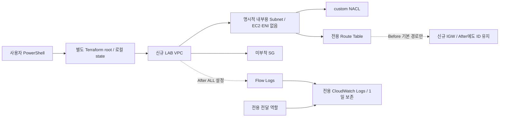

# AWS 독립 보안 진단 LAB 실행 안내

## 현재 완료 범위

이 root module은 `infra/aws/terraform/`과 별개다. 이번 구현에서는 **Terraform fmt / init -backend=false / validate, Python Mock 테스트만 수행**했다. 실제 Terraform plan/apply/destroy, AWS SDK/CLI API, 리소스 생성/변경은 실행하지 않았다. provider 설치는 Terraform Registry의 HashiCorp 서명 AWS 6.72.0을 사용했고 `.terraform.lock.hcl`에 기록했다.

원본 실제 실행(PASS 2 / FAIL 4 / NEEDS_REVIEW 2)은 그대로 보존한다. 아래 FAIL→PASS는 아직 실행하지 않은 계획이며 합성 테스트가 실제 결과를 대신하지 않는다.

## 구성



EC2, ENI, NAT Gateway, Elastic IP, VPC Endpoint, peering, TGW, 기존 VPC data source, import, provisioner, 외부 module이 없다. 기존 리소스를 Terraform 입력으로 받는 변수도 없다. 이름은 `scanner-p2audit-` + 6~12자리 고유 소문자/숫자 접미사다.

태그는 Project, Environment=isolated-lab, Owner(비밀정보 없는 별칭), Purpose=phase2-security-audit, ManagedBy=terraform-phase2-audit-lab이다. 태그를 지원하는 리소스에는 provider default_tags로 적용한다. 라우트, 연결 객체, NACL entry, IAM inline policy처럼 개별 태그를 지원하지 않는 객체는 같은 LAB 부모에만 연결하고 사전검사에서 부모 ID를 대조한다.

## Before / After

| 진단 | Before | After | 증명하지 않는 것 |
|---|---|---|---|
| SG-01 | 미부착 SG에 TCP 21/23/3389, 0.0.0.0/0 | 세 ingress rule 제거, SG ID 유지 | 실제 외부 접속 가능성 |
| NACL-01 | In/Out 규칙 100: IPv4 전체 allow | Inbound deny 50/51/52: 198.51.100.10/32의 TCP 22/23/3389, 기존 100보다 먼저 적용 | 실제 패킷 시험/전체 IP·포트 공간 |
| VPC-01 | 처음부터 내부용으로 지정한 Subnet, 자동 공인 IPv4=true, IGW 직접 기본 경로 | 자동 공인 IPv4=false, 기본 경로 resource 제거 | 실제 도달 가능성/기존 Default VPC 취약성 확정 |
| FL-01 | VPC Flow Logs 없음 | 동일 VPC ALL Flow Logs, 집계 간격 60초, 전용 Logs/역할 | 실제 로그 레코드 발생·전달 성공 |

NACL의 동일 행렬은 source=198.51.100.10, destination_port=22/23/3389, return_port=55000, expected=BLOCK이다. 문서용 주소의 설정 분석 기준이며 그 주소에서 패킷을 송신하지 않는다. Outbound 반환 규칙 100도 함께 분석한다.

태그를 지원하는 주요 자원 9개(VPC/Subnet/IGW/RouteTable/SG/NACL/LogGroup/Role 및 After FlowLog)에 관리 태그를 사용한다. Terraform 관리 객체는 Before 17개, After 17개다. 전환에서는 subnet 설정 1개 update, SG ingress 3개와 public route 1개 delete, NACL deny 3개와 FlowLog 1개 create, 나머지 stable 객체 12개 no-op을 예상한다. AWS가 VPC에 자동 생성하는 default route table/NACL/SG는 별도 Terraform 관리 resource가 아니며 다른 VPC의 기본 자산을 가져오지 않는다.

로그 그룹/전달 역할/inline policy와 IGW는 Before부터 유지한다. FlowLog ID는 after에 새로 생기지만 scope에 미리 요구하지 않으므로 before/after 수집 범위 해시를 고정할 수 있다. IGW 자체는 After에도 남지만 기본 경로가 없다. 비교 완료 후 destroy에서 정리한다.

## 기존 VPC 부분 수집 원인

원본 라이브 실행의 직접 사유는 `partial_collection_no_pass`다. API 페이지는 모두 완료됐으나 scope에 없던 ENI를 제외하면 수집기 topology()가 complete=false로 바꾼다. 이전 코드가 이 제외 사유를 warnings에 남기지 않아 저장 자료만으로 ENI ID·개수를 확정할 수 없었다. 이번 수정은 고정 코드 `ENI_filtered_outside_explicit_resource_scope`만 남기며 원본 ENI 내용은 출력하지 않는다. 기존 판정/증적은 수정하지 않는다.

명시된 Subnet의 DescribeNetworkInterfaces가 정상 빈 목록이면 완전 수집이다. 새 LAB은 ENI를 만들지 않아 이 경우를 Mock으로 검증했다. 외부에서 LAB에 ENI를 붙이면 자동 승인하지 않고 다시 부분 수집으로 남긴다. section의 next_token_present=true는 현재 통합 미완료 표식일 수도 있으므로 실제 AWS NextToken 존재로 단정하지 않는다.

## 안전성 검사

`python -m scripts.prepare_aws_audit_lab check-plan`은 **저장된 JSON만** 읽는다. subprocess, Terraform, SDK를 실행하지 않는다.

- 예상 계정/서울 리전/LAB 이름/소유자와 provider allowed_account_ids를 확인한다.
- 신규 root의 알려진 resource 주소·유형 외 자산, data source/module, import/move/deposed/replace, drift/지연된 변경을 거부한다.
- 초기 계획은 빈 prior state와 create만 허용한다. 이후에는 소유 태그·LAB 내부 부모 연결·state ID를 확인한다.
- 기존 개인 scope에 등록한 Default VPC/SG/NACL/역할 등의 ID/ARN이 계획에 들어오면 거부한다.
- 전환에서는 stable 자원의 교체/불필요한 update를 거부한다. Subnet 설정 변경과 정해진 rule/route/FlowLog 변화만 허용한다.
- 반환된 plan JSON, 실제 apply할 binary plan과 Terraform 소스를 사람이 함께 검토한다. JSON 검사는 독립적인 live 소유권 인증이 아니고 의도적으로 직접 Terraform을 실행하는 사용자를 강제로 막는 IAM 권한 계층도 아니다. 초기 빈 state만으로 리소스가 이미 존재하지 않음을 보증하지 않는다. 태그 기반 IAM 제한과 신규 이름 충돌/기존 state 확인이 필요하다.

`export-scope`는 실제 생성 후의 `terraform output -json`과 `terraform show -json` 결과를 대조한다. ID를 임의 생성하지 않는다. 원래 개인 scope는 보호·계정/IAM 문맥으로만 읽고 기존 EC2 리소스 목록은 새 LAB ID로 완전히 교체한다. 실제 output/state를 확보하기 전에는 live용 scope를 생성하지 않는다. CLI의 export 출력은 Git 제외된 프로젝트 reports/ 내부로 제한한다. 고유 하위 디렉터리와 파일 SHA-256 receipt를 만들며 독립 검증 완료로 표시하지 않는다.

## 0. 로컬 사전검증 — AWS 연결 없음

프로젝트 루트에서 실행한다. Terraform fmt는 의도한 소스 포맷만 변경하고 init은 이 root의 provider만 준비한다. 이 단계에서 plan/apply/destroy를 실행하지 않는다.

```powershell
Set-Location C:\Projects\infrastructure-security-scanner-clone
terraform -chdir=infra/aws/security-audit-lab fmt -check -recursive
terraform -chdir=infra/aws/security-audit-lab init -backend=false -input=false
terraform -chdir=infra/aws/security-audit-lab validate -no-color
.\.venv\Scripts\python.exe -B -m unittest tests.test_aws_audit_lab tests.test_aws_scope_v2 tests.test_aws_live tests.test_aws_audit
```

## 1. 사용자 승인 이후에만: 개인 변수/별도 state 준비

아래 이후의 plan은 STS/읽기 API를 호출할 수 있다. 이번 Codex 작업에서는 실행하지 않았다. 현재 계정/리전, 필요 권한, 서울 리전 비용, CIDR 충돌/공유 연결 없음, 신규 이름, 리소스 제한, 정리 시점을 먼저 확인한다. 예시 CIDR은 계획값이며 기존 망과 충돌 검사를 수행했다는 뜻이 아니다.

같은 PowerShell 세션을 유지한다. `.venv` Python을 사용한다. 사용자 별칭에는 이름·이메일 같은 개인 정보를 넣을 필요가 없다.

```powershell
Set-Location C:\Projects\infrastructure-security-scanner-clone
$py = (Resolve-Path .\.venv\Scripts\python.exe).Path
$tfRoot = (Resolve-Path .\infra\aws\security-audit-lab).Path
$protected = (Resolve-Path .\config\scope.aws-collection.local.json).Path
$expected = Read-Host '예상 12자리 AWS 계정 ID'
$labName = 'scanner-p2audit-' + [guid]::NewGuid().ToString('N').Substring(0,8)
$ownerAlias = 'personal-lab'

# 다른 root/workspace/CLI 인자/endpoint를 실수로 상속하지 않음. 값은 출력하지 않음.
$unsafeEnvironment = [Environment]::GetEnvironmentVariables().Keys |
  Where-Object { $_ -match '^(TF_WORKSPACE|TF_DATA_DIR|TF_CLI_ARGS.*|AWS_ENDPOINT_URL.*)$' }
if ($unsafeEnvironment) { throw '별도 LAB 실행에 영향을 주는 환경변수를 먼저 검토하세요.' }
if (Test-Path -LiteralPath (Join-Path $tfRoot 'phase2-audit-lab.tfstate')) {
  throw '이미 LAB state가 있습니다. 새 초기 실습으로 덮어쓰지 말고 소유권과 기존 LAB을 확인하세요.'
}
$varFile = Join-Path $tfRoot 'lab.tfvars'
if (Test-Path -LiteralPath $varFile) { throw '기존 개인 tfvars를 보존하고 내용을 확인하세요.' }
@"
expected_account_id = "$expected"
region              = "ap-northeast-2"
lab_name            = "$labName"
owner               = "$ownerAlias"
vpc_cidr            = "10.206.0.0/16"
"@ | Out-File -LiteralPath $varFile -Encoding utf8 -NoClobber

$evidenceRoot = Join-Path (Get-Location) 'reports\phase2-aws-audit-lab'
New-Item -ItemType Directory -Force -Path $evidenceRoot | Out-Null
$beforeFiles = Join-Path $evidenceRoot ('before-' + [guid]::NewGuid().ToString('N'))
New-Item -ItemType Directory -Path $beforeFiles -ErrorAction Stop | Out-Null

# 이 root의 별도 로컬 state만 초기화한다. 기존 Terraform root를 지정하지 않는다.
terraform "-chdir=$tfRoot" init -input=false
if ($LASTEXITCODE -ne 0) { throw 'init 실패: 여기서 중단' }
$workspace = terraform "-chdir=$tfRoot" workspace show
if ($LASTEXITCODE -ne 0 -or $workspace -ne 'default') { throw 'default workspace만 사용하세요' }
```

## 2. Before plan → 오프라인 검사 → 명시적 승인 후 apply

```powershell
$beforePlan = Join-Path $beforeFiles 'before.tfplan'
terraform "-chdir=$tfRoot" plan -input=false "-var-file=$varFile" -var=phase=before "-out=$beforePlan"
if ($LASTEXITCODE -ne 0) { throw 'Before plan 실패' }
$beforePlanJson = Join-Path $beforeFiles 'before.plan.json'
terraform "-chdir=$tfRoot" show -json $beforePlan | Out-File -LiteralPath $beforePlanJson -Encoding utf8 -NoClobber
if ($LASTEXITCODE -ne 0) { throw 'plan JSON 출력 실패' }
& $py -B -m scripts.prepare_aws_audit_lab check-plan `
  --plan-json $beforePlanJson --phase before --initial `
  --expected-account-id $expected --lab-name $labName --owner $ownerAlias `
  --protected-scope-json $protected
if ($LASTEXITCODE -ne 0) { throw 'LAB 외부 리소스 또는 미승인 변경: apply 금지' }
Get-FileHash -Algorithm SHA256 -LiteralPath $beforePlan,$beforePlanJson

# 여기서 17개 create만 있는지, 대상과 비용을 확인하고 사용자가 명시적으로 승인한 경우에만 실행.
# 저장 plan의 apply는 추가 대화 확인이 생략되므로 승인 전에 실행하지 않는다.
terraform "-chdir=$tfRoot" apply $beforePlan
if ($LASTEXITCODE -ne 0) { throw 'apply 실패: 부분 생성 여부를 확인하고 중단. state 삭제 금지' }
```

## 3. 실제 output/state로 scope 생성 → FAIL baseline 수집

```powershell
$beforeOutputs = Join-Path $beforeFiles 'before.outputs.json'
$beforeState = Join-Path $beforeFiles 'before.state.json'
terraform "-chdir=$tfRoot" output -json | Out-File -LiteralPath $beforeOutputs -Encoding utf8 -NoClobber
if ($LASTEXITCODE -ne 0) { throw 'output 실패' }
terraform "-chdir=$tfRoot" show -json | Out-File -LiteralPath $beforeState -Encoding utf8 -NoClobber
if ($LASTEXITCODE -ne 0) { throw 'state 출력 실패' }
$scopeText = & $py -B -m scripts.prepare_aws_audit_lab export-scope `
  --outputs-json $beforeOutputs --state-json $beforeState --output-root $beforeFiles `
  --expected-account-id $expected --lab-name $labName --owner $ownerAlias `
  --protected-scope-json $protected
if ($LASTEXITCODE -ne 0) { throw '실제 LAB scope 생성 실패' }
$scopeDir = ($scopeText | ConvertFrom-Json).directory
$labScope = Join-Path $scopeDir 'scope.json'
$labTargets = Join-Path $scopeDir 'targets.json'
& $py -B -m scripts.run_aws_audit --validate-inputs `
  --scope-json $labScope --targets-json $labTargets `
  --expected-account-id $expected --allowed-region ap-northeast-2
if ($LASTEXITCODE -ne 0) { throw 'scope 검증 실패' }
$beforeText = & $py -B -m scripts.run_aws_audit --live-collect `
  --scope-json $labScope --targets-json $labTargets `
  --expected-account-id $expected --allowed-region ap-northeast-2 `
  --max-calls 80 --max-pages 5 --max-retries 1 --connect-timeout 3 --read-timeout 8 --max-seconds 120 `
  --output-root $beforeFiles
if ($LASTEXITCODE -ne 0) { throw 'Before 수집 실패' }
$beforeRun = ($beforeText | ConvertFrom-Json).run_directory
Get-Content -LiteralPath (Join-Path $beforeRun 'report.json') -Raw |
  ConvertFrom-Json | Select-Object -ExpandProperty results |
  Select-Object check_id,status,reason,collection_complete
```

SG/NACL/VPC/FL 네 항목에서 실제 FAIL이 확인돼야 다음으로 진행한다. 다른 상태면 원인을 분석하고 baseline을 보존한다. 루트 두 항목과 기존 역할/CT 문맥은 별도 채널로 남긴다. 기존 실 계정 보고서의 PASS/NEEDS_REVIEW/FAIL을 새 보고서에 강제로 복사하지 않는다.

## 4. 사용자 개선 승인 이후: After plan → 검사 → apply → 재수집

```powershell
$afterFiles = Join-Path $evidenceRoot ('after-' + [guid]::NewGuid().ToString('N'))
New-Item -ItemType Directory -Path $afterFiles -ErrorAction Stop | Out-Null
$afterPlan = Join-Path $afterFiles 'after.tfplan'
terraform "-chdir=$tfRoot" plan -input=false "-var-file=$varFile" -var=phase=after "-out=$afterPlan"
if ($LASTEXITCODE -ne 0) { throw 'After plan 실패' }
$afterPlanJson = Join-Path $afterFiles 'after.plan.json'
terraform "-chdir=$tfRoot" show -json $afterPlan | Out-File -LiteralPath $afterPlanJson -Encoding utf8 -NoClobber
if ($LASTEXITCODE -ne 0) { throw 'After plan JSON 실패' }
& $py -B -m scripts.prepare_aws_audit_lab check-plan `
  --plan-json $afterPlanJson --phase after --baseline-state-json $beforeState `
  --expected-account-id $expected --lab-name $labName --owner $ownerAlias `
  --protected-scope-json $protected
if ($LASTEXITCODE -ne 0) { throw '예상하지 않은 전환/외부 자산: apply 금지' }
Get-FileHash -Algorithm SHA256 -LiteralPath $afterPlan,$afterPlanJson
# 예상 전환과 비용을 검토하고 사용자 개선 승인을 받은 뒤에만 실행
terraform "-chdir=$tfRoot" apply $afterPlan
if ($LASTEXITCODE -ne 0) { throw 'After apply 실패: 중단하고 기존 증적 보존' }

$afterOutputs = Join-Path $afterFiles 'after.outputs.json'
$afterState = Join-Path $afterFiles 'after.state.json'
terraform "-chdir=$tfRoot" output -json | Out-File -LiteralPath $afterOutputs -Encoding utf8 -NoClobber
if ($LASTEXITCODE -ne 0) { throw 'After output 실패' }
terraform "-chdir=$tfRoot" show -json | Out-File -LiteralPath $afterState -Encoding utf8 -NoClobber
if ($LASTEXITCODE -ne 0) { throw 'After state 실패' }
& $py -B -m scripts.prepare_aws_audit_lab export-scope `
  --outputs-json $afterOutputs --state-json $afterState --output-root $afterFiles `
  --baseline-scope-json $labScope `
  --expected-account-id $expected --lab-name $labName --owner $ownerAlias `
  --protected-scope-json $protected
if ($LASTEXITCODE -ne 0) { throw '전후 scope/ID 불일치: 비교 중단' }

# 고정된 before scope로 같은 자산을 재수집
$afterText = & $py -B -m scripts.run_aws_audit --live-collect `
  --scope-json $labScope --targets-json $labTargets `
  --expected-account-id $expected --allowed-region ap-northeast-2 `
  --max-calls 80 --max-pages 5 --max-retries 1 --connect-timeout 3 --read-timeout 8 --max-seconds 120 `
  --output-root $afterFiles
if ($LASTEXITCODE -ne 0) { throw 'After 수집 실패' }
$afterRun = ($afterText | ConvertFrom-Json).run_directory
Get-Content -LiteralPath (Join-Path $afterRun 'report.json') -Raw |
  ConvertFrom-Json | Select-Object -ExpandProperty results |
  Select-Object check_id,status,reason,collection_complete
```

Flow Logs가 PENDING이거나 전달 실패 메타데이터가 있으면 PASS를 강제하지 않는다. 필요하면 대기 후 새 수집 디렉터리를 남긴다. 데이터가 없는 LAB이므로 실제 로그 레코드 생성/전달 검증은 NOT_TESTED다. 추가 패킷 실습에는 별도 승인과 비용 검토가 필요하다.

## 5. JSON/PDF 전후 비교 — 저장 자료만 사용

live CLI에는 --baseline-json을 함께 넣지 않는다. 실제 개선 후 snapshot을 오프라인 평가하면서 원본 수집 시각/증적 참조를 보존한다. 비교 산출물의 생성 시각은 재분석 시각이다.

```powershell
$compareDir = Join-Path $evidenceRoot ('comparison-' + [guid]::NewGuid().ToString('N'))
New-Item -ItemType Directory -Path $compareDir -ErrorAction Stop | Out-Null
& $py -B -m scripts.run_aws_audit `
  --input-json (Join-Path $afterRun 'snapshot.json') --scope-json $labScope `
  --baseline-json (Join-Path $beforeRun 'report.json') `
  --output (Join-Path $compareDir 'comparison.json') `
  --pdf (Join-Path $compareDir 'comparison.pdf')
if ($LASTEXITCODE -ne 0) { throw '오프라인 비교 실패' }
```

실제 같은 자산·계정·기준·scope 해시·규칙 버전·시간 순서와 완전한 수집이 충족될 때만 네 항목 IMPROVED_OBSERVED를 기대한다. scope를 바꾸거나 기존 Default VPC 보고서를 baseline으로 사용하면 안 된다. 독립 해시/조치 인과/실제 패킷·로그 전달까지 입증한 것으로 표현하지 않는다.

## 6. 사용자 정리 승인 후: destroy 계획과 잔여 확인

먼저 before/after 증적과 state를 private 디렉터리에 보존한다. 다른 Terraform root나 `terraform state rm`/import를 사용하지 않는다. 아래는 실제 After 상태까지 진행한 경우다. Before에서 종료한다면 destroy plan의 phase 변수를 before로, baseline-state-json은 $beforeState로 맞춘다.

```powershell
$cleanup = Join-Path $evidenceRoot ('cleanup-' + [guid]::NewGuid().ToString('N'))
New-Item -ItemType Directory -Path $cleanup -ErrorAction Stop | Out-Null
$destroyPlan = Join-Path $cleanup 'destroy.tfplan'
terraform "-chdir=$tfRoot" plan -destroy -input=false "-var-file=$varFile" -var=phase=after "-out=$destroyPlan"
if ($LASTEXITCODE -ne 0) { throw 'destroy 계획 실패' }
$destroyJson = Join-Path $cleanup 'destroy.plan.json'
terraform "-chdir=$tfRoot" show -json $destroyPlan | Out-File -LiteralPath $destroyJson -Encoding utf8 -NoClobber
if ($LASTEXITCODE -ne 0) { throw 'destroy JSON 실패' }
& $py -B -m scripts.prepare_aws_audit_lab check-plan `
  --plan-json $destroyJson --phase destroy --baseline-state-json $afterState `
  --expected-account-id $expected --lab-name $labName --owner $ownerAlias `
  --protected-scope-json $protected
if ($LASTEXITCODE -ne 0) { throw 'LAB 이외 삭제 위험: 정리 중단' }
# 삭제 대상 확인 및 사용자 정리 승인 후에만 실행. terraform destroy를 맹목적으로 실행하지 않음.
terraform "-chdir=$tfRoot" apply $destroyPlan
if ($LASTEXITCODE -ne 0) { throw '정리 실패: state를 삭제하지 말고 잔여 자산 확인' }
terraform "-chdir=$tfRoot" state list
```

저장된 destroy plan을 apply하는 방식은 `terraform destroy -var-file=... -var=phase=after`에 해당하는 정리 동작이지만 검토한 계획을 고정한다. 직접 destroy 명령은 별도 미검토 계획을 즉석 실행하므로 권장하지 않는다.

이후 사용자가 AWS 콘솔/별도 승인된 읽기 전용 조회로 해당 Project 태그와 정확한 LAB 이름의 VPC/Subnet/SG/NACL/RouteTable/IGW/FlowLog/LogGroup/Role/inline policy 잔여를 확인해야 한다. `state list`가 비어 있는 것만으로 AWS 잔여 없음의 독립 증명이 되지는 않는다. custom NACL association을 제거할 때 같은 신규 LAB VPC의 기본 NACL로 복귀할 수 있으나 기존 Default VPC에는 연결하지 않는다. subnet 삭제 뒤 IGW/route table/VPC가 의존 순서로 정리된다. 로그 그룹은 별도 실제 삭제 여부를 확인하고, 전달 역할의 inline policy도 제거됐는지 확인한다. 정리 실패 시 원인 기록 후 해당 LAB만 대상으로 재시도하며 다른 환경을 중단/삭제하지 않는다.

## 비용 및 필요한 권한

계정 전체 관리자 권한을 새로 만들거나 기존 SSM 역할에 부착하지 않는다. 변경 주체와 읽기 진단 주체를 분리한다. Terraform provider가 상태 조회에 사용하는 Describe/Get/List 권한도 필요하다. 다음은 작업군이며 실제 최소 정책의 서비스별 ARN/태그 조건 지원은 첫 plan 전에 검토해야 한다.

- EC2/VPC: Create/DeleteVpc, ModifyVpcAttribute, Create/DeleteSubnet, ModifySubnetAttribute, Create/DeleteSecurityGroup, Authorize/RevokeSecurityGroupIngress, SG rule tags, Create/DeleteNetworkAcl, Create/DeleteNetworkAclEntry, ReplaceNetworkAclAssociation, Create/DeleteRouteTable, Associate/DisassociateRouteTable, Create/DeleteRoute, Create/Attach/Detach/DeleteInternetGateway, Create/DeleteFlowLogs, Create/DeleteTags, 관련 Describe/Get.
- CloudWatch: Create/DeleteLogGroup, PutRetentionPolicy/DeleteRetentionPolicy, DescribeLogGroups/ListTagsForResource/TagResource/UntagResource 등 provider 조회·태그 동작.
- IAM: 신규 LAB 이름의 Create/Get/DeleteRole, Tag/UntagRole, Put/Get/DeleteRolePolicy, ListRolePolicies/ListAttachedRolePolicies, 필요 provider 조회. iam:PassRole은 전용 flow-delivery 역할과 PassedToService=vpc-flow-logs.amazonaws.com에만 제한한다. 수집 대상 기존 SSM 역할의 변경 권한은 부여하지 않는다.
- 로그 전달 역할: 미리 생성된 전용 log-group ARN 하위의 CreateLogStream/PutLogEvents/DescribeLogStreams. DescribeLogGroups만 Resource=*로 별도 허용. CreateLogGroup은 역할에 주지 않는다. Trust는 VPC Flow Logs 서비스 + SourceAccount + 서울 리전 해당 계정 vpc-flow-log ARN 조건이다.

SG/NACL 자체 추가 요금은 없지만 AWS 전체 무료를 보장하지 않는다. 기본 LAB에는 compute/NAT/public IPv4 시간 비용이 없다. CloudWatch의 로그 수집·보관 비용은 실제 데이터량에 따르며, 1일 보존과 실제 그룹 삭제를 구분한다. 로그가 발생하지 않으면 전달 성공을 주장하지 않는다. 부가 KMS key/CloudTrail/Lake/Insights를 생성하지 않는다. 최소 실행 시간·예산을 정하고 정리 후/청구 반영 이후 CloudWatch, EC2/VPC, IAM 관련 잔여 자원을 다시 확인한다. 프리 티어를 비용 보장의 근거로 사용하지 않는다.

## 아직 검증하지 않은 부분

실제 plan JSON 형식과 IAM 권한/조직 SCP, AWS 생성/전환/삭제, 서비스 전파 지연, Flow Logs 활성·전달, 실제 네트워크 통신은 아직 미검증이다. Terraform validate는 AWS API 성공이나 계정 내 자원 존재 여부 검증이 아니다. guard/export는 합성 Terraform JSON으로 검증했다. 실제 saved plan이 안전성 검사를 통과하지 못하면 우회하지 말고 차이를 분석한 뒤 진행한다. before→after 불필요한 교체 방지는 설계/Mock 수준으로 확인했으며 실제 plan에서 다시 확인해야 한다.

공식 참고:
- https://developer.hashicorp.com/terraform/cli/commands/validate
- https://developer.hashicorp.com/terraform/cli/commands/init
- https://developer.hashicorp.com/terraform/internals/json-format
- https://docs.aws.amazon.com/vpc/latest/userguide/flow-logs-iam-role.html
- https://docs.aws.amazon.com/vpc/latest/userguide/nacl-rules.html
- https://aws.amazon.com/cloudwatch/pricing/

## 부모 조회 속성 drift의 제한적 동기화 허용

After plan 검사에는 원본 Before의 `terraform show -json` 파일을 `--baseline-state-json`으로 전달한다. resource_drift는 전면 해제하지 않는다. IAM Role의 inline_policy, NACL의 ingress/egress/subnet_ids, Route Table의 route, SG의 ingress만 허용 후보이며 실제 전체 자식 리소스와 정확히 일치해야 한다. 부모/자식 ID와 LAB 태그, baseline의 완전한 자식 목록, 승인 외 속성 불변, 부모 계획 no-op을 확인한다. 누락/중복/외부 자원/정책 효과·조건·CIDR·포트·방향·경로 차이는 거부한다. JSON 키/리스트 순서만 의미 없는 표현 차이로 처리한다. 같은 의미의 정책 JSON 공백·키 순서는 파싱해 비교하지만 중복 키는 거부한다.

새 Plan 검증 후에만 적용하고, 과거 DO-NOT-APPLY가 있는 Plan은 적용하지 않는다. 현재 AWS 상태와 관계없이 과거 실패 Plan을 새 승인 대상으로 바꾸지 않는다. 허용한 조회 동기화의 주소와 필드는 guard 결과 approved_parent_readback_sync에 기록한다. baseline과 state/Plan 입력을 검사 과정에서 수정하지 않는다. 적용할 binary Plan의 SHA-256과 scope/Before manifest도 별도로 확인한다.

```powershell
.\.venv\Scripts\python.exe -B -m unittest tests.test_aws_lab_drift tests.test_aws_audit_lab tests.test_aws_scope_v2 tests.test_aws_live tests.test_aws_audit
```
